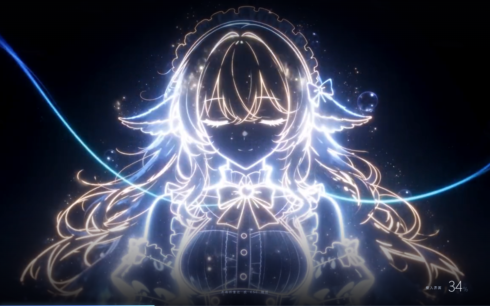

# 深潜启动序列 · dsh-boot-dive

给 **DeepSeek Harness** 的开机动画：8 秒 720p 短片，鲸鱼女仆从霓虹线稿逐渐长成实体；片子完整播完后停一帧，再淡出进主界面。

片子**内联在启动 HTML 里**（data URI），不经过路由、不发外部请求，也没有广告或引流；另保留一条纯代码的鲸鱼线稿模式，随时可切。



- 支持 `dsh web` 和 DSH Desktop（同一套注入行）
- 优先带声自动播放；被浏览器拒绝就静音起播并提示“点击开启声音”，点一下开声、再点一下才进入
- 点击 / `Esc` / 空格 / 回车随时跳过
- 播完再淡出（默认 800ms）；硬上限 14 秒，纯 CSS 兜底 15.5 秒
- 片子坏了 / 解码失败：深色底 + HUD 撑一下，然后直接放行
- 尊重 `prefers-reduced-motion`：减弱动效时跳过缩放类动画，仍会正常交接

---

## 一、它演什么

| 时间 | 画面 |
| --- | --- |
| `0.0s` | 黑场，霓虹线条开始勾出人物轮廓 |
| `0.4s` | 发丝、头饰、翅膀状耳饰逐段亮起，光带从两侧掠过 |
| `1.6s` | 线稿补全，胸口宝石与蝴蝶结成形 |
| `2.0–4.0s` | 白色过曝洗过画面，角色由线稿变成实体 |
| `4.0–8.10s` | 实体角色停在画面中央，气泡与粒子缓慢上浮，直到片子最后一帧 |
| `8.10–8.90s` | 最后一帧停住，800ms 淡出，主界面显形 |
| 全程 | 右下百分比与阶段、底部细进度条；没有品牌、自检、片名这些装饰 |
| 异常 | 视频不可用 → 深色底撑 1.6 秒后放行；脚本全挂 → CSS 在 15.5 秒隐藏遮罩 |

跳过：点击任意处、`Esc`、空格、回车。跳过走 420ms 快速淡出，不会硬切。

纯代码模式（`mode: code`）仍是原来那支：深海底、鲸鱼线稿逐笔绘制、声呐环、启动日志，2.8 秒起可以交接。`preview/code.html` 可以直接看。

---

## 二、它是怎么接进 DSH 的

这是所有「DSH 开机动画」插件共同的做法，也是这个项目最值得看的部分。

### 1. 为什么不能用普通前端插件

DSH 的浏览器半边插件要等插件条目激活后才运行，那时 DSH 自己的 `HARNESS / Loading plugins…` 启动卡已经画出来了；官方实践也禁止插件去 `append` `document.body` 或替换 app root。

**唯一能赶在应用 UI 之前出现的层，是启动 HTML 本身。**

### 2. 宿主注入三行

`dsh-host-webserver` 在每次渲染 `index.html` 时发出 `webserver/index-inject` 事件，插件往里 push 结构化行（纯 JSON，可序列化）：

| 行 | 位置 | 内容 |
| --- | --- | --- |
| `style` | `<head>` | 整段遮罩与 HUD 的 CSS |
| `html` | `<body>` 开头、`#root` 之前 | `<video>` + 遮罩 + HUD |
| `script` | `<body>` | 交接逻辑：片尾 / 上限 / 跳过 |

```js
ctx.on('webserver/index-inject', (table) => {
	table.push({ kind: 'style', text: style });
	table.push({ kind: 'html', placement: 'body', html: markup });
	table.push({ kind: 'script', placement: 'body', text: script });
});
```

### 3. 片子为什么内联，而不是走路由

片子只有 1 MB 左右，转成 base64 后接在 `<video src="data:video/mp4;base64,…">` 里。

这样做换来三件事：

- **桌面版不用碰 origin**：DSH Desktop 的页面是 `dsh-app://`，走 HTTP 路由要考虑自定义协议的转发与 CORS；data URI 没有这个问题。
- **没有会 404 的引用**：桌面解释器加载外部 `<script src>` 或媒体失败会连带影响启动完成信号，内联没有这个失败面。
- **没有额外请求**：启动时只解析约 1.7 MB 的 HTML（本地），不排队等媒体路由。

代价是 HTML 变大、片子只能整段替换；对“每次开机放一段”来说这笔账是划算的。想要放自己的片子，见第九节。

### 4. 首帧、背景与声音

- `moov` 在 `mdat` 前面（faststart）：浏览器读前几 KB 就能出第一帧，不会先黑一屏；
- **不设 `poster`**：片子的第一帧就是黑场，和遮罩底色一致。之前用第 1.4 秒的线稿当封面，浏览器会先画封面、再跳回第一帧，看起来像“先闪一下快成形的画面，然后从头播”——现在这个封面已经去掉；
- **画面保持纯黑**：不设 `poster`、也不加氛围底，视频的黑场就是遮罩底色，起播第一帧不会闪出“快成形的画面”；
- 片子重新压了一遍，保留原 AAC 音轨并做了一次响度归一（约 -19.8 dB 均值 / -1.6 dB 峰值），音量 0.9；
- 启动时**先试带声播放**。Chromium 在没有用户手势时会拒绝，这时自动退回静音播放，并把底部提示改成「点击开启声音 · ESC 跳过」；点一下只开声、不退出，第二下才进入。桌面版 Electron 允许带声自动播放时就没有这一步；
- **正常播完时不做程序化淡出**：音轨跟着片子自然结束，避免把最后一段音量压低；只有跳过或撞到硬上限时，才在 380/500ms 内把 `video.volume` 收到 0；
- 任何一步失败都走 `data-dsbdv-error` 的兜底路径。

### 5. 什么时候退场

```text
片子播到最后一帧（ended）且应用已挂载  → 停住最后一帧，再淡出 tailMs（默认 800ms）
片子已经放完但应用还没挂载              → 停在最后一帧等
应用一直不就绪                          → maxShowMs（14s）硬上限
用户点击 / 按键                         → 420ms 快速淡出
脚本全挂                                → CSS 在 15.5s 隐藏遮罩
```

“应用已挂载”看两个信号：应用自己的 `[data-dsh-boot]` 启动卡出现后消失，或 `#root` 里出现非启动卡子节点。

淡出发生在**片子播完之后**，不是从片尾往前推：`tailMs` 现在是“停住最后一帧后的淡出时长”。因此总停留约 8.1s + 0.8s；如果应用没就绪，最后一帧会一直停着，直到就绪或 14s 上限。

### 6. 为什么不会卡住

- 片长、硬上限、CSS `visibility` 三层兜底；
- 任一异常都只导致「提前露出应用」，不会导致「打不开」；
- 遮罩在退场后整块从 DOM 移除，不残留合成层。

---

## 三、安装

### 桌面版（一键）

1. **完全退出** DeepSeek Harness（窗口 + 托盘，任务管理器里确认没有 `DeepSeek Harness` 进程）；
2. 双击 **`安装到桌面版.cmd`**；
3. 重新打开 DSH。

脚本会备份 profile 的 `package.json`、写入 `link:` 依赖与 `dsh.profile.bundles`、跑一次 `dsh plugin install`。

卸载：同样先退出 DSH，双击 **`卸载.cmd`**。插件目录不会被删。

> 桌面版 profile 由应用独占管理，应用大版本更新后如果入口被重置，重新跑一次安装脚本即可。

### `dsh web` / 手动安装

```jsonc
// ~/.dsh/profiles/<profile>/package.json
"dependencies": {
  "dsh-boot-dive": "link:F:/path/to/dsh-boot-dive"
},
"dsh": { "profile": { "bundles": ["@deepseek-ai/dsh-base", "@deepseek-ai/dsh-web-app", "dsh-boot-dive"] } }
```

```powershell
dsh plugin --profile <profile> install --offline
dsh --profile <profile> --no-open
```

Windows 路径带空格时不要用 `dsh plugin add <路径>`（会被 cmd 切碎），手写 `package.json` 再 `install` 最稳。

### 只想暂停，不卸载

在 profile 的 `cordis.patch.yml` 里加：

```yaml
- id: dsh-boot-dive
  disabled: true
```

重启后生效。

---

## 四、配置

同一个 `cordis.patch.yml`，写进这一行的 `config:` 块，重启生效：

```yaml
- id: dsh-boot-dive
  name: dsh-boot-dive
  config:
    mode: video          # video（默认）/ code
    tailMs: 800          # 播完后停住最后一帧的淡出时长，400–5000
    maxShowMs: 14000     # 硬上限，2000–60000
    sound: true          # 先试带声播放；关掉就完全静音
    allowSkip: true
    accent: '#5b8cff'    # 进度条主色
```

`mode: code` 时还可以用：

```yaml
    minShowMs: 2800      # 鲸鱼线稿最短停留，800–15000
    wordmark: DEEPSEEK
    tagline: DIVE SEQUENCE
```

不写就是默认值。配置读取做了类型与范围收敛，写错不会把启动页弄坏。

---

## 五、预览与自检

不用装也能先看：

- **`preview/index.html`** —— 视频版（默认），和插件注入的是同一份 CSS/HTML/JS；
- **`preview/code.html`** —— 纯代码鲸鱼版；
- 视频版地址加 `?t=3.2` 可以停在某一秒慢慢看；加 `?sound=0` 可以看完全静音的分支；
- 改完资源跑一次：

```powershell
node tools/build-preview.mjs   # 重新生成两份预览
node tools/check.mjs           # 79 项静态自检，零依赖
```

`check.mjs` 会核对：三行注入、占位符、每个 class 是否有样式、有无外链、片子是不是真的 mp4 且 `moov` 在 `mdat` 前、硬上限与 CSS 兜底是否长于交接路径、跳过与兜底是否还在。

---

## 六、验证情况

已在隔离 profile（临时的 `bootlab`，验证后已清理）里用真实的 `dsh web` 跑通：

- 首页约 1.70 MB（注入 HTML 1,627,131 字节），里面能看到 `data:video/mp4;base64`、`data-sound="1"` 与三行注入；
- 第 2 秒视频在播（`currentTime≈1.6`，`readyState=4`），进度 20%；
- 无手势环境：带声播放被拒 → `muted=true`、底部出现「点击开启声音 · ESC 跳过」的胶囊提示；点一下后 `muted=false`、`volume=0.9`、画面继续，第二下才退出；
- 启动参数允许自动播放时：`muted=false` 直接带声播放，`webkitAudioDecodedByteCount` 在 2.5 秒内累计 43,723 字节，确认音轨真的在解码；
- 第 8.1 秒播到最后一帧，停住后开始 800ms 淡出，约 9.0 秒遮罩移除；
- 按 `Esc` 后 549ms 遮罩消失；
- 控制台无报错。

**桌面版未在本机重启实测**（重启会中断当前会话）。桌面版 profile 已经接好（`link:F:/DeepSeek Work1/dsh-boot-dive` + `bundles` 里含 `dsh-boot-dive`，`node_modules` 是指向本目录的 junction），重启后走同一张结构化注入表；如果你重启后没看到动画，先跑 `卸载.cmd` 回报。

---

## 七、文件结构

```text
dsh-boot-dive/
  package.json              # dsh.bundle.patch 声明
  cordis.patch.yml          # 把插件插进 profile 层栈
  lib/index.js              # 宿主半边：读资源、拼三行、订阅 index-inject
  assets/
    boot-video.css          # 视频版遮罩/HUD
    boot-video.html         # <video> + HUD（片子以 data URI 注入）
    boot-video.js           # 播完后淡出、上限、跳过、兜底
    boot.css / boot.html / boot.js   # 纯代码鲸鱼模式
    video/boot.mp4          # 8.1s、720p、AAC 音轨、faststart
  preview/index.html        # 视频版离线预览（构建产物）
  preview/code.html         # 纯代码版离线预览
  tools/build-preview.mjs
  tools/check.mjs
  tools/install-desktop.ps1 / uninstall-desktop.ps1
  安装到桌面版.cmd / 卸载.cmd
  docs/preview.png
```

想自己改：

| 想改 | 改哪里 |
| --- | --- |
| 片长、淡出时长 | 换 `assets/video/boot.mp4`；`tailMs` / `durationMs` |
| HUD 文案、位置、颜色 | `assets/boot-video.css` / `boot-video.html` |
| 交接时机 | `assets/boot-video.js` 的 `tail` 判断与 `beginExit()` |
| 鲸鱼线稿 | `assets/boot.html` + `boot.css`（`mode: code`） |

---

## 八、换自己的视频

把新的 mp4 覆盖到 `assets/video/boot.mp4` 即可，不需要另外做封面（不设 poster，避免起播前闪一帧）。推荐参数：

```powershell
ffmpeg -i 原片.mp4 -c:v libx264 -preset slow -crf 26 -pix_fmt yuv420p `
  -af "loudnorm=I=-19:TP=-1.5:LRA=9" -c:a aac -b:a 128k -ar 48000 `
  -movflags +faststart assets/video/boot.mp4
```

- **保留音轨**：`-af loudnorm` 把响度压到一个适合开机的区间；不想要声音就在配置里写 `sound: false`，或干脆 `-an`；
- **`-movflags +faststart`**：把 `moov` 挪到文件头，否则第一帧要等整段下完；
- **控制在 4 MB 以内**：base64 会膨胀 1/3，太大就不适合内联了；
- 片长不是 8 秒也没关系：JS 优先读 `video.duration`，`durationMs` 只是读不到元数据时的兜底，改一下更稳。

---

## 九、素材与许可

- **影片**：来自 [lxj5820/dsh-boot-animation](https://github.com/lxj5820/dsh-boot-animation) 的 `assets/videos/1.mp4`（MIT），角色与画面由该项目的作者制作；这里只做内联与播放器接线。
- **插件代码 / 纯代码鲸鱼模式**：本项目原创，MIT。

工程上参考过这些项目（只学做法，没有复用素材）：

| 项目 | 学到什么 |
| --- | --- |
| [lxj5820/dsh-boot-animation](https://github.com/lxj5820/dsh-boot-animation) | 片尾交叉溶解、启动卡时序、素材缓存与 faststart 的坑 |
| [KylinQ01/dsh-startup-animation](https://github.com/KylinQ01/dsh-startup-animation) | 多层动效、收尾对齐、桌面版 `tapIndex` 失效的根因 |
| [oumaekumiko0821/dsh-splash-gojo](https://github.com/oumaekumiko0821/dsh-splash-gojo) | 最干净的纯 host 半边：三行注入、就绪信号、CSS 兜底 |
| [yannicksong0106/dsh-550c-boot](https://github.com/yannicksong0106/dsh-550c-boot) | 分幕节奏、首帧遮 Loading |
| [LeeRolling/dsh-boot-suite](https://github.com/LeeRolling/dsh-boot-suite) | 注入行幂等（双遮罩 = 黑屏）的踩坑记录 |

## License

MIT。影片素材版权归原作者；「DeepSeek」「DeepSeek Harness」是其权利人的商标，本项目与官方无隶属关系。完整素材署名见 [NOTICE](NOTICE)。
